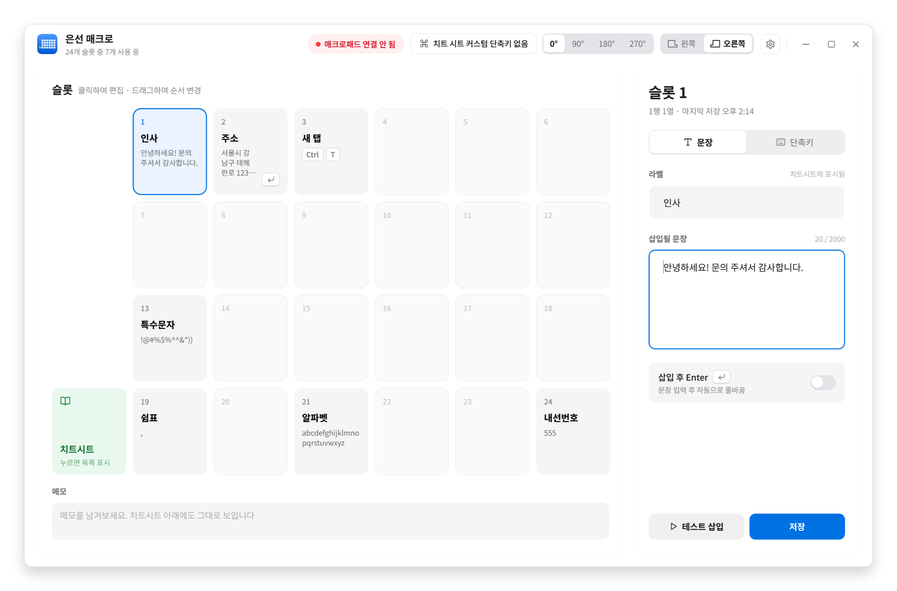
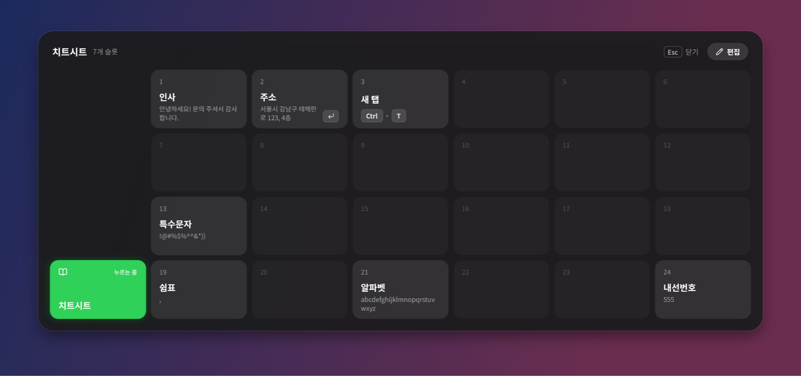

# 문장 매크로 (MacroTyper)

[](https://github.com/codeyoma/custom_macro_for_qmk/releases/latest)

QMK 매크로패드의 키를 누르면 Windows 에서 지금 커서가 있는 자리에 등록해 둔 문장이 입력된다.

**[최신 릴리즈 받기](https://github.com/codeyoma/custom_macro_for_qmk/releases/latest)**

<p align="center">
  
</p>

<p align="center">
  
</p>

## 특징

- Helix Pico 한쪽 PCB(키 25개): 슬롯 24칸 + 치트시트 키. 왼쪽·오른쪽 PCB 모두 지원
- 슬롯마다 **문장** 또는 **단축키**(예: `Ctrl + Shift + T`)
- 클립보드를 건드리지 않고, 저장한 글자 그대로 입력
- 레이어 키를 누르는 동안 치트시트가 뜨고, 칸을 마우스로 눌러도 입력된다
- 문장을 바꿔도 펌웨어는 다시 굽지 않는다. 키보드는 슬롯 번호만 보낸다
- 트레이 상주, 새 버전이 나오면 알리고 눌러서 업데이트

## 시작하기

1. 릴리즈의 hex 를 PCB 쪽에 맞춰 굽는다. 오른쪽은 `helix_pico_eunsun_right.hex`, 왼쪽은 `helix_pico_eunsun_left.hex` → [펌웨어 설치](firmware/helix_pico_macro/README.md)
2. `MacroTyper-win-x64-standalone.exe` 를 실행한다. 트레이에 상주한다.
3. 트레이 아이콘을 더블클릭해 관리창을 열고 문장을 등록한다. 왼쪽 PCB 라면 위쪽에서 **왼쪽**을 고른다.

> 한쪽만 쓸 때는 **TRRS 케이블을 뽑아 두세요.** 꽂힌 채로 반대쪽에 전원이 없으면 키보드가 멈춘다.

## 사용법

| 하고 싶은 것 | 방법 |
|---|---|
| 슬롯 편집 | 격자에서 칸을 누른다 |
| 두 슬롯 맞바꾸기 | 칸을 다른 칸으로 끌어다 놓는다 |
| 세워 놓고 쓰기 | 위쪽에서 0° · 90° · 180° · 270° 를 고른다 |
| 매크로패드 없이 치트시트 | 위쪽 **치트 시트 단축키**에 조합을 등록한다(토글). 떠 있을 때 `Esc` 로 닫는다 |
| 늘 보이는 메모 | 관리창 아래 메모. 치트시트 아래에도 뜬다 |
| 설정 백업·복원 | 톱니 → 저장하기 `Ctrl+S` · 불러오기 `Ctrl+O` · 저장 위치 열기 `Ctrl+Shift+O` |

설정은 `%APPDATA%\MacroTyper\slots.json` 에 있어 새 버전으로 바꿔도 남는다.

## 알려진 제약

- **관리자 권한 창에는 입력되지 않는다.** 필요하면 트레이 메뉴의 **관리자 권한으로 재시작**을 쓴다.
- **게임에는 입력되지 않는다.** DirectInput·Raw Input 게임은 주입된 입력을 무시한다.
- **한글 IME 전각 모드로 친 문장은 전각으로 저장된다.** 관리창은 타이핑하는 전각을 반각으로 바꾸고,
  이미 저장된 전각은 주황 점과 **반각으로 바꾸기** 버튼으로 알려 준다.
- **v0.3.0 은 서명 없이 배포됐다.** v0.2.x 에서는 자동 교체가 안 되니 릴리즈에서 직접 받아 덮어쓴다.

## 개발

| 프로젝트 | 대상 | 내용 |
|---|---|---|
| `MacroTyper.Core` | `net8.0` | 프로토콜, 슬롯 저장, 입력 변환. Windows 없이 테스트된다 |
| `MacroTyper` | `net8.0-windows` | WPF 화면, 트레이, `SendInput` |
| `MacroTyper.Tests` | `net8.0` | Core 단위 테스트 |

```bash
dotnet test tests/MacroTyper.Tests/MacroTyper.Tests.csproj
```

```bash
qmk compile -kb helix/pico -km eunsun -e SIDE=left
```

### 릴리즈

```bash
scripts/publish-release.sh && scripts/sign-windows.sh publish/release/MacroTyper-win-x64-standalone.exe
```

자동 업데이트가 아래에 묶여 있으니 지킨다.

- `src/MacroTyper/MacroTyper.csproj` 의 `<Version>` 과 git 태그를 맞춘다.
- 같은 인증서로 서명한다. 다른 키나 무서명이면 설치된 앱이 업데이트를 거부한다.
- exe 이름 `MacroTyper-win-x64-standalone.exe` 를 바꾸지 않는다.

## 문서

- [펌웨어 설치](firmware/helix_pico_macro/README.md)
- [설계 문서](docs/superpowers/specs/2026-07-27-qmk-macro-typer-design.md)
